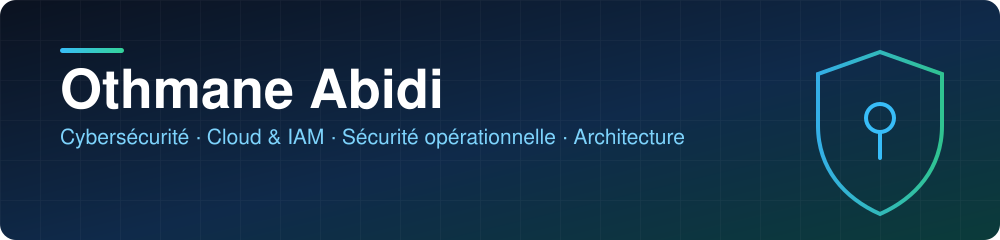
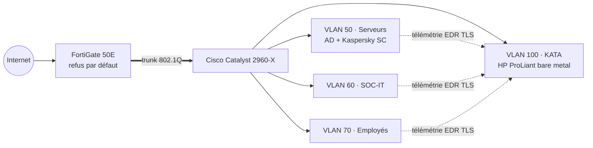
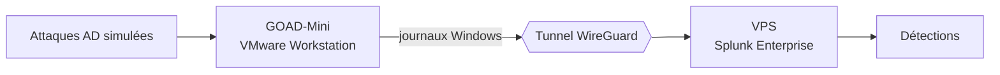

 

## 👤 À propos

Élève-ingénieur à l'**EMSI Rabat** et en double diplôme **Master 2 IA** à l'**Université Côte d'Azur**. Je conçois, construis et teste des environnements de sécurité, puis je documente ce que j'ai fait, pourquoi je l'ai fait et ce qui n'a pas marché du premier coup.

## 🧭 Mes trois axes

<table>
<tr>
<td width='33%' valign='top'>

### ☁️ Cloud & IAM
Moindre privilège, RBAC, ABAC, audit de posture cloud.

[AWS IAM RBAC/ABAC](https://github.com/othmane71-art/aws-iam-policies-rbac-abac-lab) · [AWS IAM identités](https://github.com/othmane71-art/aws-iam-identities-least-privilege-lab) · [Audit cloud](https://github.com/othmane71-art/cloud-exposure-audit-nmap-zap-prowler)

</td>
<td width='33%' valign='top'>

### 🛡️ Sécurité opérationnelle
Remontée de logs, détection, triage d'alertes, forensics.

[Sentinel SOC Lab](https://github.com/othmane71-art/Microsoft-Sentinel-SOC-Lab) · [ARCHISOC](https://github.com/othmane71-art/ARCHISOC-LAB-HOME) · [SOC Simulator](https://github.com/othmane71-art/tryhackme-soc-simulator-phishing-triage) · [Forensics](https://github.com/othmane71-art/forensic-artefacts-goad-mini-kali)

</td>
<td width='33%' valign='top'>

### 🧩 Architecture & conseil
Infrastructures segmentées sur matériel réel, benchmark de solutions, livrables rédigés.

Projet phare ECS Informatique, ci-dessous.

</td>
</tr>
</table>

## 🛠️ Stack manipulée

**SIEM, EDR, détection**

      

**Cloud et IAM**

   

**Réseau et architecture**

     

**Offensif, forensics, analyse**

      

**Automatisation et développement**

      

## ⭐ Projet phare : infrastructure de cybersécurité centralisée

> [!NOTE]
> **ECS Informatique** · stage de juillet à septembre 2026 · matériel réel : FortiGate 50E, Cisco Catalyst 2960-X, serveur HP ProLiant.

> [!IMPORTANT]
> **Problématique.** Dans la majorité des entreprises accompagnées par ECS, le système d'information repose sur un domaine Active Directory sans segmentation rigoureuse ni EDR centralisé. Une fois un poste compromis, l'attaquant peut atteindre les serveurs sensibles, dont le contrôleur de domaine. Comment limiter la propagation d'une menace tout en administrant la sécurité des postes de façon centralisée et en faisant remonter les événements vers une plateforme de détection avancée ?

### Architecture

### Pourquoi ces choix

- **Segmentation en 4 VLAN** (serveurs, SOC-IT, employés, management KATA) pour limiter le mouvement latéral (MITRE ATT&CK TA0008).
- **FortiGate en refus par défaut** : tout flux inter-VLAN est bloqué sauf exception justifiée, avec des objets adresse en /32 pour que chaque droit soit lié à un serveur précis.
- **Active Directory calqué sur l'organisation métier**, pour appliquer des GPO et des politiques Kaspersky différenciées par groupe.
- **Kaspersky KATA/KEDR** pour obtenir de la télémétrie EDR exploitable, au-delà d'un antivirus classique.

### Obstacles rencontrés et solutions

| Obstacle | Cause | Solution |
|---|---|---|
| Pas de VLAN tagging 802.1Q natif sur VMware Workstation | Limite de l'hyperviseur pour transporter plusieurs VLAN | Combinaison Hyper-V (commutateur virtuel externe en trunk) et VMware Workstation pour les VM |
| Console Kaspersky Security Center instable (Not Responding), erreur SQL Server 701 | Conflit connu entre SQL Server 2019 sans CU12 et une procédure interne de KSC (mécanisme Scalar UDF Inlining) : explosion de la consommation mémoire | Application du correctif officiel (TSQL_SCALAR_UDF_INLINING = OFF). Mémoire disponible passée d'environ 457 Mo à 9,6 Go |
| Déploiement distant des agents sur les postes | Dépendance à SMB (ports 139/445) et aux droits administrateur | Règles FortiGate dédiées avec journalisation, pare-feu Windows configuré en PowerShell, tâches de déploiement séparées par groupe |

### Validation et résultats

- Attaques simulées sur un poste employé, alignées MITRE ATT&CK : téléchargement du fichier de test EICAR (bloqué avant écriture sur disque) et récupération d'un objet distant via PowerShell (T1105 / T1059.001, requête interceptée).
- Détection vérifiée à trois niveaux : alerte locale, journal Windows, console centrale.
- Télémétrie EDR confirmée du poste jusqu'au Central Node KATA, en TLS.

> [!WARNING]
> **Limites assumées.** Environnement de laboratoire restreint, solution utilisée en mode évaluation, et une règle SOC-IT vers employés qu'il faudrait resserrer en production. J'ai aussi proposé des pistes (SOAR, intégration SIEM) dans un benchmark face aux EDR concurrents.

## 🔧 Projets

### En cours : GOAD-Mini + Splunk sur VPS via WireGuard

Remonter de façon sécurisée les logs d'un Active Directory vulnérable (GOAD-Mini d'Orange Cyberdefense, sur VMware Workstation) vers Splunk hébergé sur un VPS.

### Réalisations

<table>
<tr>
<td width='50%' valign='top'>
<a href='https://github.com/othmane71-art/aws-iam-policies-rbac-abac-lab'><b>AWS IAM : RBAC, ABAC, moindre privilège</b></a> 
Appliquer le moindre privilège sur AWS émulé (LocalStack) : RBAC par groupes, rôle temporaire AssumeRole, ABAC testé au simulateur. 
Cloud & IAM
</td>
<td width='50%' valign='top'>
<a href='https://github.com/othmane71-art/aws-iam-identities-least-privilege-lab'><b>AWS IAM : identités, refus par défaut, MFA</b></a> 
Poser les bases d'identités IAM sécurisées : groupes, refus par défaut, politique de mot de passe, MFA. 
Cloud & IAM
</td>
</tr>
<tr>
<td valign='top'>
<a href='https://github.com/othmane71-art/cloud-exposure-audit-nmap-zap-prowler'><b>Audit d'exposition et posture cloud</b></a> 
Mesurer la surface d'exposition et la posture cloud avec Nmap, OWASP ZAP et Prowler, puis interpréter côté SOC et architecture. 
Cloud & conseil
</td>
<td valign='top'>
<a href='https://github.com/othmane71-art/Microsoft-Sentinel-SOC-Lab'><b>Microsoft Sentinel SOC Lab</b></a> 
Monter un SOC hybride de bout en bout avec SIEM/SOAR et règles de détection KQL. 
Sécurité opérationnelle
</td>
</tr>
<tr>
<td valign='top'>
<a href='https://github.com/othmane71-art/ARCHISOC-LAB-HOME'><b>ARCHISOC-LAB-HOME</b></a> 
Reproduire une architecture SOC virtualisée : FortiGate, pfSense, Wazuh, honeypot Cowrie, WAF, DVWA. 
Sécurité opérationnelle
</td>
<td valign='top'>
<a href='https://github.com/othmane71-art/forensic-artefacts-goad-mini-kali'><b>Forensics GOAD-Mini et Kali</b></a> 
Investiguer les artefacts volatils et persistants d'un Windows Server AD et d'un Kali, selon l'ordre de volatilité (RFC 3227). 
Forensics
</td>
</tr>
<tr>
<td valign='top'>
<a href='https://github.com/othmane71-art/tryhackme-soc-simulator-phishing-triage'><b>TryHackMe SOC Simulator : triage de phishing</b></a> 
Qualifier des alertes de phishing avec Splunk et rédiger des rapports de cas SOC niveau 1. 
Sécurité opérationnelle
</td>
<td valign='top'>
<a href='https://github.com/othmane71-art/ai-soc-traffic-anomaly-detection'><b>Détection d'anomalies de trafic</b></a> 
Construire une baseline de trafic réseau et détecter les anomalies par résidus, en vue d'une intégration à Splunk. 
IA & SOC
</td>
</tr>
<tr>
<td valign='top'>
<a href='https://github.com/othmane71-art/network-intrusion-detection-logreg'><b>Détection d'intrusions par régression logistique</b></a> 
Classifier le trafic réseau normal ou anormal avec scikit-learn. 
IA & SOC
</td>
<td valign='top'>
<b>Prochainement</b> 
Dépôt GOAD-Mini + Splunk + WireGuard, avec documentation complète. 
Sécurité opérationnelle
</td>
</tr>
</table>

## 🏅 Régularité et apprentissage

- **TryHackMe** : Top 2 %, série de 203 jours consécutifs, plus de 2 600 activités en 2026.
- **Certifications** : Fortinet NSE 1, 2 et 3, ISO/IEC 27001:2022 Information Security Associate, Cisco CCNA Foundations et Intermédiaire.

## 📬 Contact

[LinkedIn](https://www.linkedin.com/in/othmane-abidi/) · [othmaneabidi71@gmail.com](mailto:othmaneabidi71@gmail.com)

